# UDIP v3 Architecture Overview

## High-Level System Design

UDIP (Unified Data Ingestion Platform) is a modular Streamlit-based platform for radio astronomy data analysis, featuring a clean separation between UI, orchestration, execution, and scientific computation layers.

### Core Architecture Layers



---

## Layer Responsibilities

### 1. **UI Layer** (Streamlit Pages)
- **Location**: `pages/`, `udip_pages/`
- **Responsibility**: User interaction, form inputs, pipeline visualization
- **Examples**:
  - `pages/agent_pipeline.py` - Pipeline builder interface
  - `udip_pages/visualize.py` - Data visualization and charts
  - `udip_pages/data_forge.py` - Data transformation UI
  - `udip_pages/ai_assistant.py` - AI chat interface

### 2. **Pipeline Builder** (`modules/pipeline_builder.py`)
- **Responsibility**: Visual pipeline construction using drag-and-drop nodes
- **Key Classes**:
  - `PipelineBuilder` - main orchestrator
  - `Pipeline` - pipeline definition
  - `PipelineNode` - individual computation node
  - `PipelineConnection` - node dependencies
- **Output**: Converts visual pipeline into structured `execution_plan` format
- **Critical Change (Fixed)**: No longer executes pipelines locally; delegates to `pipeline_runner`

### 3. **Pipeline Runner** (`modules/pipeline_runner.py`)
- **Responsibility**: Orchestrate sequential execution of validated pipeline steps
- **Key Functions**:
  - `run_pipeline(plan: dict) -> dict` - main execution entry point
  - `_validate_plan()` - validate execution plan structure
  - `run_batch_pipeline()` - parallel multi-file execution
- **Supported Actions** (50+):
  - Data: `load_dataset`, `run_sql`, `clean_data`, `save_dataset`, `merge_datasets`
  - ML: `train_model`, `run_clustering`, `engineer_features`
  - HIRAX: `detect_rfi`, `compute_fft`, `power_spectrum`, `classify_signal`, `calibrate_signal`
  - Export: `generate_report`, `create_visualization`, `generate_ai_report`

### 4. **Execution Layer** (`modules/execution_layer.py`)
- **Responsibility**: Controlled boundary for data I/O and safe operations
- **Guarantees**:
  - Structured return format: `{"success": bool, "output": Any, "error": str}`
  - No direct file system access outside `udip_data/`
  - All operations logged and wrapped with error handling
- **Key Functions**:
  - `load_dataset(file_path)` - read CSV, JSON, Parquet, HDF5, etc.
  - `save_dataset(df, name)` - persist to Parquet
  - `run_sql(query)` - DuckDB query execution
  - `merge_datasets()` - controlled join operations
- **Data Format Support**: `.csv`, `.tsv`, `.json`, `.jsonl`, `.parquet`, `.xlsx`, `.feather`, `.h5`, `.hdf5`

### 5. **Scientific Modules** 
- **Radio Interferometry**: `modules/radio_interferometry.py`
  - UV coverage analysis
  - PSF computation
  - Baseline modeling
  
- **HIRAX-Specific**: 
  - `modules/hirax_analysis.py` - FFT, calibration, windowing, peak detection
  - `modules/hirax_processing.py` - RFI detection and cleaning
  
- **Data Science**:
  - `modules/feature_alchemy.py` - feature engineering
  - `modules/data_fusion.py` - dataset merging and transformation
  
- **AI/ML**:
  - `modules/ai_engine.py` - LLM integration (Groq API)
  - `modules/observatory_intelligence.py` - signal intelligence

- **Experimental/Orphaned**:
  - `modules/hirax_elite_enhancer.py` - currently not referenced by runtime

### 6. **Data Layer**
- **Core**: `modules/core.py`
  - History management
  - HDF5 metadata helpers
  - Dataset persistence
  
- **Memory**: `modules/dataset_memory.py`
  - In-memory dataset snapshots
  - Version control for datasets
  
- **Storage**: `udip_data/`
  - Datasets: `udip_data/datasets/`
  - History: `udip_data/history/history.json`
  - Chats: `udip_data/chats/`
  - Code: `udip_data/code/`
  
- **HDF5 Support**: `modules/scientific_hdf5.py`
  - Structured HDF5 file navigation
  - Metadata normalization
  - Axis inference for scientific data

---

## Key Architectural Decisions

### ✅ Layered Separation of Concerns
- **UI** does NOT know about execution details
- **Execution** is agnostic to UI framework
- **Science modules** are pure compute (no Streamlit/UI imports)
- **Execution layer** is the only data boundary

### ✅ Plan-Based Execution
- UI builds pipelines as data structures (not code)
- Plans are validated before execution
- Enables reproducibility, logging, and batch processing

### ✅ Structured Responses
- All operations return `{"success", "output", "error"}` consistently
- Enables uniform error handling at UI level
- Facilitates logging and experimentation tracking

### ✅ No Hidden Coupling
- Before fix: `pipeline_builder.py` had inline execution stubs
- After fix: Builder only creates plans; `pipeline_runner` executes
- Result: single source of truth for execution logic

---

## Critical Runtime Paths

### Standard Pipeline Execution
1. User builds pipeline in UI (`pages/agent_pipeline.py`)
2. Pipeline Builder creates `Pipeline` object with `PipelineNode` instances
3. User clicks "Execute"
4. Builder converts nodes to `execution_plan` (list of action dicts)
5. Runner validates plan against `ALLOWED_ACTIONS`
6. Runner executes steps sequentially, passing DataFrame forward
7. Each step updates session state with logs
8. Final result rendered in UI

### Direct Execution (No Builder)
- Pages like `udip_pages/data_forge.py` call `execution_layer` functions directly
- Used for one-off operations (load, transform, save)
- Still follows structured response pattern

### Batch Execution
- `run_batch_pipeline()` parallelizes same plan across multiple files
- Uses `ProcessPoolExecutor` with N-1 cores

---

## Session State Model

```
st.session_state {
  "datasets": Dict[str, DataFrame],          # loaded/saved datasets
  "history": List[Dict],                     # action history log
  "chat_history": List[Dict],                # AI conversation
  "pipeline_builder": {
    "current_pipeline": Pipeline | None,
    "saved_pipelines": Dict[str, Pipeline],
    "execution_status": PipelineStatus,
    "execution_history": List[ExecutionResult]
  },
  "execution_logs": List[Dict],              # step-by-step logs
  "final_output": Any,                       # last execution result
  "hirax_rfi_mask": np.ndarray | None,       # RFI detection result
  "hirax_cleaned_data": np.ndarray | None,   # RFI-cleaned visibilities
  ...other page-specific state...
}
```

---

## Deployment

### Development
```bash
cd udip_v3
.\venv\Scripts\Activate.ps1
streamlit run app.py
```

### Production
```bash
tray.py  # Windows system tray launcher
```

### Build
```bash
PyInstaller UDIP.spec  # Creates standalone UDIP.exe
```

---

## Next Steps for Users

1. **To add a new data operation**: Add a handler in `pipeline_runner.py` and `execution_layer.py`
2. **To add a UI page**: Create in `udip_pages/` or `pages/` and import from `modules/`
3. **To add a science algorithm**: Implement in `modules/`, expose via `execution_layer` or `pipeline_runner`
4. **To integrate a new data source**: Extend `execution_layer.load_dataset()` with new format support

