# UDIP v3 Data Model

Complete specification of UDIP's data representation, storage, and lifecycle.

---

## Core Data Structures

### DataFrame as Primary Representation
All data flowing through UDIP pipelines is represented as **pandas.DataFrame**:
- **Rows**: Observations, time samples, or baseline measurements
- **Columns**: Data channels (frequency, magnitude, phase, stokes parameters, etc.)
- **Index**: Temporal or spatial ordering

### Schema Flexibility
UDIP supports arbitrary column schemas:
- Pure numerical (visibility magnitudes, phases, amplitudes)
- Mixed (frequency [numeric] + antenna_pair [categorical])
- Complex-valued (stored as separate real/imag columns or numpy complex arrays)

---

## Data Lifecycle



---

## File Formats & Support

### Input Formats

| Format | Extension | Reader | Support Level |
|--------|-----------|--------|---|
| CSV | `.csv` | pandas.read_csv | ✅ Full |
| TSV | `.tsv` | pandas.read_csv(sep='\t') | ✅ Full |
| JSON | `.json` | pandas.read_json | ✅ Full |
| JSON Lines | `.jsonl` | pandas.read_json(lines=True) | ✅ Full |
| Parquet | `.parquet` | pandas.read_parquet | ✅ Full |
| Excel | `.xlsx` | pandas.read_excel | ✅ Full |
| Feather | `.feather` | pandas.read_feather | ✅ Full |
| HDF5 | `.h5`, `.hdf5` | _read_hdf5 (custom) | ✅ Full (Special) |

### HDF5 Special Handling

**File**: `modules/execution_layer.py::_read_hdf5(file_path)`

```python
def _read_hdf5(file_path: str) -> pd.DataFrame:
    """
    Load HDF5 into pandas DataFrame with intelligent dataset selection.
    
    Logic:
    1. Open HDF5 file
    2. Recursively find all datasets (ignore groups)
    3. Select largest by element count
    4. Convert to DataFrame:
       - If 2D: columns = HDF5 dataset column names (or auto-generated)
       - If 1D: wrap in single-column DataFrame
       - If N-D: flatten or reshape to 2D
    5. Return DataFrame
    """
    with h5py.File(file_path, "r") as f:
        datasets = find_all_datasets(f)
        largest_ds = max(datasets, key=lambda d: d.size)
        return to_dataframe(largest_ds)
```

**Metadata Extraction**: `modules/scientific_hdf5.py`

- `normalize_hdf5_attrs(attrs: dict) -> dict`
  - Extract structured metadata (units, instrument, etc.)
  - Flatten nested attributes
  - Infer data type from attributes if possible

- `infer_scientific_axis_metadata(dataset, attrs) -> dict`
  - Detect frequency axis, time axis, spatial axes
  - Return normalized metadata: `{"frequency": {...}, "time": {...}}`

---

## Session State Model

### Top-Level Keys

```python
st.session_state = {
    # Navigation & UI state
    "current_page": str,                      # Currently displayed page
    
    # Dataset management
    "datasets": Dict[str, pd.DataFrame],      # Loaded/created datasets
    "current_dataset_name": str | None,       # Active dataset for UI
    
    # History tracking
    "history": List[Dict],                    # Action history log
    
    # Chat interface
    "chat_history": List[Dict],               # AI conversation log
    
    # Code editor
    "editor_code": str,                       # User-written code snippet
    
    # Dashboard
    "dashboard_pins": Dict[str, Any],         # Pinned visualizations
    
    # Pipeline builder
    "pipeline_builder": {
        "current_pipeline": Pipeline | None,
        "saved_pipelines": Dict[str, Pipeline],
        "execution_status": PipelineStatus,
        "execution_history": List[ExecutionResult],
        "execution_logs": List[Dict]
    },
    
    # Execution state (populated during pipeline run)
    "execution_logs": List[Dict],             # Step-by-step logs
    "execution_plan": Dict,                   # Current plan being executed
    "final_output": Any,                      # Last execution result
    "final_summary": str,                     # Human-readable result summary
    
    # HIRAX analysis results (side effects of specific actions)
    "hirax_rfi_mask": np.ndarray | None,      # Boolean mask from detect_rfi
    "hirax_cleaned_data": np.ndarray | None,  # Cleaned visibility data
    "hirax_windowed_data": np.ndarray | None, # After apply_window
    "hirax_fft_result": Dict,                 # FFT spectrum
    "hirax_power_spectrum": Dict,             # Power spectrum
    "hirax_calibrated_data": np.ndarray | None,  # After calibrate_signal
    
    # Other analysis results
    "uv_coverage": Dict,                      # UV plane analysis
    "detection_results": Dict,                # Peak detection output
    "classification_results": Dict,           # Signal classification
    
    # UI-specific state (various pages)
    "data_forge_settings": Dict,
    "sql_editor_query": str,
    ...
}
```

### History Entry Schema

```python
{
    "timestamp": "2024-01-15T10:30:45.123Z",
    "action": str,                      # "load_dataset", "clean_data", etc.
    "user": str | None,                 # Username if authenticated
    "parameters": Dict,                 # Action input parameters
    "result_summary": str,              # Brief description of outcome
    "status": "success" | "failed",     # Execution status
    "duration_ms": float,               # Time taken (ms)
    "datasets_affected": List[str],     # Dataset names involved
    "error": str | None                 # Error message if failed
}
```

---

## Memory Systems

### 1. Session State (Streamlit)
- **Scope**: Single user session, lives in browser's connection
- **Lifetime**: Session duration (until browser closes)
- **Size**: Typically 100MB–1GB
- **Persistence**: Automatically cleared when session ends

### 2. Disk Cache (udip_data/)
- **Scope**: Persistent across sessions
- **Location**: `udip_data/datasets/`, `udip_data/history/`, `udip_data/code/`
- **Format**: Parquet (datasets), JSON (history), Python (code snippets)
- **Retention**: User must delete manually

### 3. In-Memory Dataset Snapshots (dataset_memory.py)
- **Purpose**: Checkpoint datasets during analysis for quick rollback
- **API**:
  ```python
  from modules import dataset_memory
  snapshot_id = dataset_memory.save_snapshot("my_dataset", df)
  restored_df = dataset_memory.load_snapshot(snapshot_id)
  ```
- **Lifetime**: Session duration
- **Max Size**: Configurable (default 500MB)

### 4. Experiment Tracking (experiment_tracker.py)
- **Purpose**: Scientific reproducibility
- **Records**: Dataset ID, pipeline steps, parameters, results
- **Location**: `udip_data/experiments/experiment_YYYYMMDD_HHMMSS.json`
- **Used by**: HIRAX-specific pipelines for automatic logging

---

## Dataset Import & Export

### Import Workflow


**Size Limits**:
- Max single file: 500 MB (configurable)
- Max session memory: 2 GB (auto-spill to disk)
- Max total on disk: 10 GB (user warning)

### Export Workflow

```python
# From execution_layer.save_dataset(df, name):
1. Validate DataFrame (no NaN in critical columns, etc.)
2. Infer best format:
   - If contains complex: HDF5 (.h5)
   - Else if has many columns: Parquet
   - Else: CSV for simplicity
3. Write to udip_data/datasets/<name>.<ext>
4. Return {"success": True, "path": full_path, "format": format_chosen}
```

**Supported Exports**:
- Parquet (preferred for numerical data)
- CSV (human-readable)
- JSON (API integration)
- HDF5 (scientific collaboration)
- Excel (non-technical stakeholders)

---

## Complex Data Handling

### Visibility Data (HIRAX)

**Representation**: Complex-valued matrix or DataFrame

```python
# In HDF5:
dataset["visibilities"] = [N_freq, N_time, N_baseline] complex128 array

# In DataFrame:
df = pd.DataFrame({
    "frequency_Hz": [...],
    "time_s": [...],
    "baseline_id": [...],
    "visibility_real": [...],         # Re(V)
    "visibility_imag": [...],         # Im(V)
    "magnitude": [...],               # |V|
    "phase_rad": [...]                # arg(V)
})
```

### Multi-Index Support

Some operations require multi-dimensional indexing:

```python
# Example: baseline matrix indexed by antenna pair
df = pd.DataFrame({
    "antenna1": [1, 1, 2, 2, ...],
    "antenna2": [2, 3, 3, 4, ...],
    "visibility_real": [...],
    "visibility_imag": [...]
})

# Convert to multi-index for advanced grouping:
df_multi = df.set_index(['antenna1', 'antenna2'])
```

### Time-Series Representation

Frequency and time data are stored as separate columns:

```python
df = pd.DataFrame({
    "frequency_Hz": [1.4e9, 1.4e9, 1.4e9, ...],  # Repeated for each time
    "time_s": [0, 1, 2, 0, 1, 2, ...],            # Cycles through times
    "power_Jy": [...]                              # Or visibility magnitude
})
```

---

## Data Validation

### Input Validation (`execution_layer.py`)

```python
# Before any operation:
def _validate_dataframe(df: pd.DataFrame) -> bool:
    """Check DataFrame is not empty and has expected structure."""
    if df is None or df.empty:
        return False
    if not isinstance(df.columns, pd.Index):
        return False
    return True

# Type checking:
def _require_numeric_column(df: pd.DataFrame, col: str) -> bool:
    """Check column is numeric."""
    return pd.api.types.is_numeric_dtype(df[col])
```

### Output Validation

All operations return structured result:
```python
{
    "success": bool,
    "output": Any,              # The actual result (DataFrame, array, dict)
    "error": str | None,        # Error message if failed
    "metadata": Dict | None     # Optional: stats, shape, dtype info
}
```

---

## Performance Optimization

### Lazy Loading
- HDF5 files are NOT fully loaded on import
- Only requested datasets are read
- Reduces memory footprint for multi-TB files

### Chunking for Large Files
```python
# For files > 100MB:
chunk_size = 10000
for chunk in pd.read_csv("large_file.csv", chunksize=chunk_size):
    # Process chunk without loading entire file
    result = process_chunk(chunk)
    save_result(result)
```

### Index Optimization
```python
# For repeated queries on same column:
df = df.set_index("frequency_Hz")  # Creates implicit index
subset = df.loc[1.4e9:1.5e9]       # Fast lookup
```

---

## Metadata Preservation

### Pandas Attributes
```python
df.attrs = {
    "instrument": "HIRAX",
    "observation_date": "2024-01-15",
    "frequency_unit": "Hz",
    "data_product": "visibility",
    "processing_level": "raw"
}
```

### HDF5 Attributes
```python
with h5py.File("obs.h5", "r") as f:
    ds = f["visibilities"]
    print(ds.attrs["frequency_range"])    # (1.4e9, 1.5e9)
    print(ds.attrs["n_antennas"])        # 128
```

---

## Data Quality Metrics

Automatically computed on load or save:

```python
# In execution_layer._compute_data_quality_metrics():
metrics = {
    "shape": df.shape,
    "dtypes": df.dtypes.to_dict(),
    "missing_percentage": (df.isnull().sum() / len(df) * 100).to_dict(),
    "numeric_stats": {
        col: {
            "min": df[col].min(),
            "max": df[col].max(),
            "mean": df[col].mean(),
            "std": df[col].std()
        }
        for col in df.select_dtypes(include=[np.number]).columns
    },
    "categorical_unique": {
        col: df[col].nunique()
        for col in df.select_dtypes(include=['object']).columns
    }
}
```

---

## Future Data Model Enhancements

- [ ] Native support for xarray (labeled N-D arrays)
- [ ] Automatic time-zone aware timestamps
- [ ] Sparse matrix support for large, sparse visibility matrices
- [ ] Columnar storage (Apache Arrow) for query acceleration
- [ ] Automatic compression for large exports
- [ ] Data lineage tracking (provenance)

