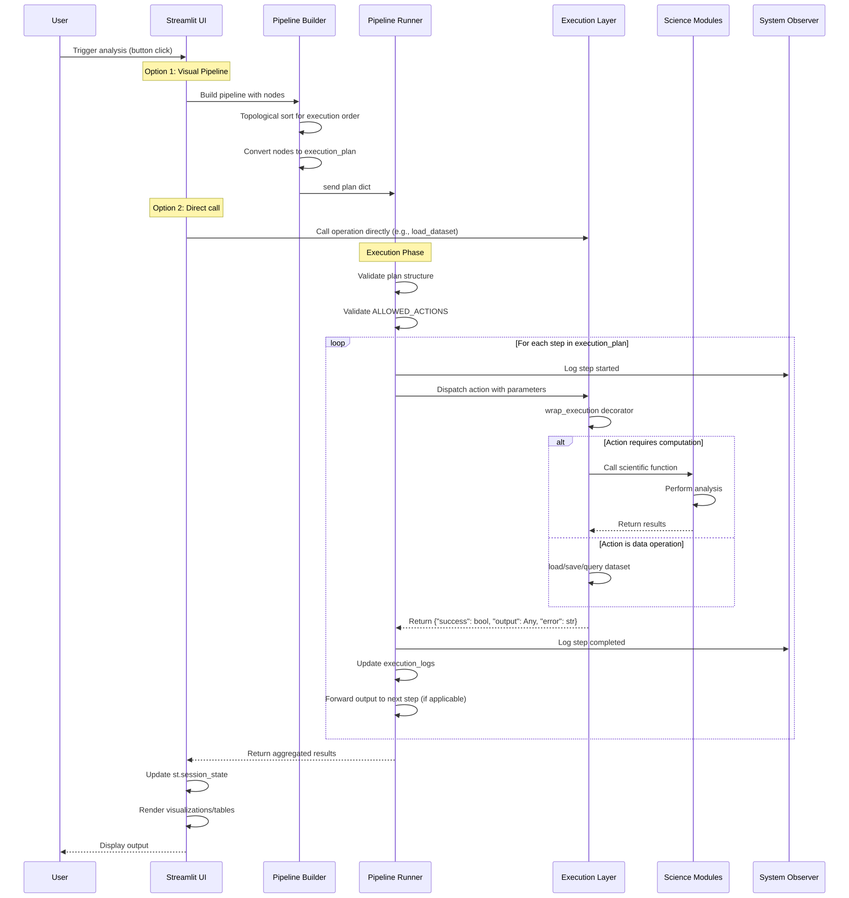

# UDIP v3 Execution Flow

## Runtime Lifecycle

This document traces a typical user action from UI trigger through to final output.

---

## Complete Execution Sequence


        
        alt Action requires computation
            EL->>SCI: Call scientific function
            SCI->>SCI: Perform analysis
            SCI-->>EL: Return results
        else Action is data operation
            EL->>EL: load/save/query dataset
        end
        
        EL-->>PR: Return {"success": bool, "output": Any, "error": str}
        PR->>SO: Log step completed
        PR->>PR: Update execution_logs
        PR->>PR: Forward output to next step (if applicable)
    end
    
    PR-->>UI: Return aggregated results
    UI->>UI: Update st.session_state
    UI->>UI: Render visualizations/tables
    UI-->>User: Display output
```

---

## Step-by-Step Walkthrough

### Phase 1: Build (UI → Pipeline Builder)

```
User clicks "Build Pipeline" in pages/agent_pipeline.py
  ↓
render_pipeline_builder_ui() initializes PipelineBuilder singleton
  ↓
User drags nodes onto canvas (NodeType.UPLOAD, NodeType.CLEAN, etc.)
  ↓
User connects nodes with edges (dependencies)
  ↓
PipelineBuilder stores in st.session_state.pipeline_builder:
  - current_pipeline: Pipeline object
  - nodes: Dict[node_id] = PipelineNode
  - connections: Dict[conn_id] = PipelineConnection
  ↓
User clicks "Execute Pipeline"
```

### Phase 2: Plan Conversion (Pipeline Builder → Pipeline Runner)

```
PipelineBuilder.execute_pipeline() called:
  1. Reset all node statuses to NodeStatus.PENDING
  2. Set pipeline status to PipelineStatus.RUNNING
  3. Spawn worker thread: _execute_pipeline_thread()
  
In worker thread:
  1. get_pipeline_execution_order()
     - Build dependency graph from connections
     - Topological sort (DFS)
     - Return ordered list of node_ids
  
  2. _build_execution_plan() [NEW: fixed in this audit]
     - For each node in execution order:
       - NodeType.UPLOAD → {"action": "load_dataset", "file_path": ...}
       - NodeType.CLEAN → {"action": "clean_data", "method": ...}
       - NodeType.MERGE → {"action": "merge_datasets", "key": ...}
       - NodeType.VISUALIZE → {"action": "create_visualization", ...}
       - NodeType.RFI_DETECTION → {"action": "detect_rfi", ...}
       - NodeType.FFT → {"action": "compute_fft", ...}
       - ... (50+ node types supported)
     - Return: List[Dict] execution_plan
  
  3. run_pipeline({"execution_plan": plan_steps})
```

### Phase 3: Execution (Pipeline Runner)

```
run_pipeline(plan) called:
  
  1. VALIDATION
     _validate_plan(plan):
       - Check plan is dict with "execution_plan" key
       - For each step:
         - Step must have "action" field
         - Action must be in ALLOWED_ACTIONS set
         - If validation fails: raise ValueError with helpful message
  
  2. INITIALIZATION
     st.session_state["execution_logs"] = []
     st.session_state["execution_plan"] = plan
     current_df = None
     last_result = None
     
  3. SEQUENTIAL EXECUTION
     for step_number, step in enumerate(validated_steps):
       
       step_start = time.time()
       
       TRY:
         action = step["action"]
         
         # DISPATCH by action type
         if action == "load_dataset":
           file_path = _require_string(step, "file_path")
           res = execution_layer.load_dataset(file_path)
           current_df = res["output"]
         
         elif action == "clean_data":
           current_df = _require_current_dataframe(current_df)
           method = _optional_string(step, "method", default="standard")
           res = execution_layer.clean_data(current_df, method)
           current_df = res["output"]
         
         elif action == "detect_rfi":
           from modules import hirax_processing
           threshold = step.get("threshold", 3.0)
           res = hirax_processing.detect_rfi(current_df.values, threshold=threshold)
           st.session_state["hirax_rfi_mask"] = res["mask"]
         
         elif action == "compute_fft":
           from modules import hirax_analysis
           s_rate = step.get("sampling_rate", 1.0)
           res = hirax_analysis.compute_fft(current_df.values, sampling_rate=s_rate)
           st.session_state["hirax_fft_result"] = res
         
         # ... (50+ actions)
         
         step_duration_ms = (time.time() - step_start) * 1000
         system_observer.log_step(run_id, step_number, action, step_duration_ms, success=True)
         
         execution_logs.append({
           "step": step_number,
           "action": action,
           "success": True,
           "summary": _summarise_result(result)
         })
       
       EXCEPT Exception as exc:
         error_tier = "ExecutionError"  # or "DataError" or "SystemError"
         system_observer.log_step(..., success=False, error_tier=error_tier)
         
         execution_logs.append({
           "step": step_number,
           "action": action,
           "success": False,
           "error_type": type(exc).__name__,
           "error": str(exc)
         })
         
         # Continue to next step (optional: early exit on critical errors)
  
  4. AUTO-LOGGING for HIRAX
     if any step is RFI or FFT or calibration:
       experiment_tracker.log_experiment(dataset_id, steps, params, results)
  
  5. FINAL RESULT
     return {
       "steps_executed": [list of step dicts],
       "status": "success" or "failed",
       "errors": [error dicts],
       "final_result": last_result,
       "final_summary": _summarise_result(last_result)
     }
```

### Phase 4: UI Rendering (Back to Streamlit)

```
Result returned to pipeline_builder._execute_pipeline_thread():
  
  For each node in execution order:
    - Map result from step_results
    - Update node.status = COMPLETED or FAILED
    - Update node.error_message if failed
  
  Update pipeline status:
    - If any node failed: PipelineStatus.FAILED
    - Else: PipelineStatus.COMPLETED
  
  st.session_state.pipeline_builder["execution_status"] = new_status
  st.session_state.pipeline_builder["execution_history"].append(result)

UI re-renders (Streamlit magic):
  - Display execution logs (green ✓ for success, red ✗ for failures)
  - Render final output (table, chart, report, etc.)
  - Update session state display
  - Make next action available (export, re-run, modify pipeline)
```

---

## Error Handling Strategy

### Validation Errors
- Caught before execution starts
- User sees friendly message about what's wrong with the plan
- Example: `"Unknown action 'typo_action'. Allowed: load_dataset, clean_data, ..."`

### Data Errors
- Step fails mid-execution (e.g., missing column, invalid SQL)
- Error captured and logged but does NOT stop pipeline
- Pipeline continues to next step if possible
- User sees step marked red with error message in execution log

### System Errors
- Unexpected exceptions in libraries
- Wrapped by `@wrap_execution` decorator
- Returns `{"success": False, "error": str(exception)}`
- Step marked as failed

### Critical Failures
- Current implementation: log and continue
- Future: configurable stop-on-error behavior

---

## Performance & Observability

### Metrics Tracked
- `step_number`: Which step in the plan
- `action`: What operation (e.g., "detect_rfi")
- `step_duration_ms`: How long the step took
- `success`: Did it work?
- `error_tier`: Type of error (DataError, ExecutionError, etc.)

### System Observer
- Logs to `modules/system_observer.py`
- Enables performance auditing and bottleneck detection

### Experiment Tracking
- For HIRAX workflows: auto-logs to `experiment_tracker`
- Captures: dataset_id, steps, parameters, results
- Enables reproducibility and scientific audit trail

---

## Branching Paths

### Direct Execution (Non-Pipeline)
```
User in data_forge.py or sql_editor.py
  ↓
Calls execution_layer function directly
  ↓
e.g., execution_layer.clean_data(df, method="standard")
  ↓
Returns structured result
  ↓
UI renders without pipeline machinery
```

### Batch Pipeline
```
User has 10 CSV files to analyze with same pipeline
  ↓
run_batch_pipeline(file_paths, plan_template)
  ↓
For each file:
  - Modify plan to use that file
  - Spawn ProcessPoolExecutor worker
  - run_pipeline(plan) in parallel
  ↓
Collect results from all workers
  ↓
Return aggregated results
```

### Interactive vs Automated
- **Interactive**: User in Streamlit session, sees logs in real-time
- **Automated**: Scheduled job or API call, logs persisted only

---

## Known Limitations & Future Improvements

### Current
- Sequential execution only (no parallel node execution within a pipeline)
- No visual progress bar during long-running steps
- Errors don't provide "suggested fix" prompts

### Planned
- Parallel subgraph execution for independent nodes
- Estimated time remaining
- AI-powered error diagnosis and recovery suggestions
- Pipeline branching (conditional steps)
- Loop support (iterate over dataset groups)

