# UDIP v3 Module Dependency Graph

Complete mapping of module imports, dependencies, and runtime relationships.

---

## Module Import Dependency Graph



    PR -->|AI| AIE["modules/ai_engine.py"]
    
    PB -->|Visual nodes| PR
    
    subgraph "Science & Analysis"
        RI
        HA
        HP
        FA
        DfM
    end
    
    subgraph "Intelligence & Output"
        OI
        AIE
    end
    
    RI -->|Baseline analysis| HA
    HA -->|Uses| HP
    OI -->|Synthesis| RI
    OI -->|Synthesis| HA
    AIE -->|Integration| SO
    
    subgraph "Orphaned (Unused)"
        ORD1["hirax_elite_enhancer.py"]
        ORD2["performance_elite.py"]
        ORD3["state_perfection.py"]
        ORD4["execution_reliability.py"]
    end
    
    style APP fill:#e8f5e9
    style CORE fill:#fff9c4
    style EL fill:#ffe0b2
    style PR fill:#ffe0b2
    style PB fill:#ffe0b2
    style RI fill:#bbdefb
    style HA fill:#bbdefb
    style HP fill:#bbdefb
    style FA fill:#bbdefb
    style DfM fill:#bbdefb
    style OI fill:#f8bbd0
    style AIE fill:#f8bbd0
    style ORD1 fill:#ffcccc
    style ORD2 fill:#ffcccc
    style ORD3 fill:#ffcccc
    style ORD4 fill:#ffcccc
```

---

## Module-by-Module Import List

### 🟢 Core Infrastructure Modules

#### **app.py** (Entry Point)
- Imports: `streamlit`, `st_pages`, `datetime`
- Core module: `modules/core.py`
- Page imports: Dynamic via `st_pages.add_page_group()`
- Session initialization: `history`, `chat_history`, `editor_code`, `dashboard_pins`, `datasets`

#### **modules/core.py** (Foundation)
```python
import streamlit as st
import h5py
import json
import datetime
from pathlib import Path
```
- **Exports**: 
  - `add_history(entry)` - History management
  - `get_datasets()`, `save_dataset()` - Dataset persistence
  - `_read_hdf5()` - HDF5 reading
  - Session state helpers
- **Used by**: All pages, all modules
- **Critical**: Backward-compatible `add_history()` now accepts both dict and legacy tuple formats

#### **modules/execution_layer.py** (Data Boundary)
```python
import pandas as pd
import numpy as np
from pathlib import Path
import functools
from modules.core import add_history
from modules.dataset_memory import save_snapshot, load_snapshot
from modules.scientific_hdf5 import normalize_hdf5_attrs
from modules.system_observer import log_step
```
- **Exports**:
  - `load_dataset(file_path)` - Universal loader (CSV, JSON, HDF5, Parquet, Excel, etc.)
  - `save_dataset(df, name)` - Universal saver
  - `run_sql(query)` - DuckDB query execution
  - `clean_data(df, method)` - Data cleaning
  - `detect_anomalies(df)` - Outlier detection
  - `merge_datasets(dfs, key)` - Join operation
  - `create_visualization(df, viz_type)` - Chart generation
  - `train_model(df, target, model_type)` - Simple ML
  - `run_clustering(df, n_clusters)` - K-means, DBSCAN
  - `detect_schema(df)` - Infer structure
  - All wrapped with `@wrap_execution` decorator for consistent `{"success", "output", "error"}` return
- **Used by**: `pipeline_runner.py`, pages calling execution layer directly
- **Key Feature**: Structured boundary - no direct file I/O outside `udip_data/`

#### **modules/pipeline_runner.py** (Orchestration)
```python
import streamlit as st
from modules.execution_layer import (
    load_dataset, save_dataset, run_sql, clean_data, 
    detect_anomalies, merge_datasets, create_visualization, 
    train_model, run_clustering, detect_schema
)
from modules import (
    hirax_analysis, hirax_processing, radio_interferometry,
    feature_alchemy, data_fusion, observatory_intelligence, ai_engine
)
from modules.system_observer import log_step
```
- **Exports**:
  - `run_pipeline(plan: dict)` - Main execution entry point
  - `run_batch_pipeline(file_paths, plan_template)` - Parallel execution
  - `ALLOWED_ACTIONS` - Set of 50+ supported actions
- **Responsibilities**:
  - Validate execution plans
  - Dispatch to appropriate module (execution_layer or science module)
  - Collect results and forward to next step
  - Log execution metrics
  - Handle errors without stopping pipeline
- **Key Fix Applied**: Now pure orchestrator; no local execution stubs
- **Used by**: `pipeline_builder.py`, UI pages for batch operations

#### **modules/pipeline_builder.py** (Visual Pipeline Definition)
```python
import streamlit as st
from enum import Enum
from dataclasses import dataclass
from datetime import datetime
from modules.pipeline_runner import run_pipeline
```
- **Classes**:
  - `NodeType` enum: 27+ node types (UPLOAD, CLEAN, MERGE, RFI_DETECTION, FFT, POWER_SPECTRUM, etc.)
  - `Pipeline` - Main pipeline container
  - `PipelineNode` - Individual computation node
  - `PipelineConnection` - Dependency edge
  - `PipelineStatus`, `NodeStatus` - Status tracking
  - `PipelineBuilder` - Main UI orchestrator
- **Methods**:
  - `render_pipeline_builder_ui()` - Draw canvas and node palette
  - `_build_execution_plan()` - **[FIXED]** Convert visual nodes to `execution_plan` dict list
  - `execute_pipeline()` - Spawn worker thread
  - `_execute_pipeline_thread()` - **[FIXED]** Call `run_pipeline()` instead of local execution
- **Key Fix Applied**: 
  - Added `_build_execution_plan()` to convert 27+ node types to execution action dicts
  - Refactored `_execute_pipeline_thread()` to call `run_pipeline()` delegating all execution to pipeline_runner
  - Before: Builder had execution stubs (duplicated logic)
  - After: Builder is pure definition layer
- **Used by**: `pages/agent_pipeline.py`

---

### 🔵 Science & Analysis Modules

#### **modules/radio_interferometry.py** (Radio Astronomy)
```python
import numpy as np
import pandas as pd
from modules.hirax_analysis import apply_window
```
- **Functions**:
  - `generate_uv_coverage(u_coords, v_coords, times=None)` - UV plane histogram
  - `compute_psf(u_coords, v_coords)` - Point spread function
  - `analyze_baseline_distribution(u_coords, v_coords)` - Baseline statistics
- **Used by**: Observatory intelligence, visualization pages
- **Data In**: Baseline coordinates (wavelength units)
- **Data Out**: Coverage statistics, PSF properties

#### **modules/hirax_analysis.py** (HIRAX Core)
```python
import numpy as np
import scipy.signal
import scipy.fft
```
- **Functions**:
  - `apply_window(data, window_type)` - Hann/Hamming/Blackman windowing
  - `compute_fft(data, sampling_rate)` - FFT via numpy/scipy
  - `compute_power_spectrum(data, sampling_rate)` - |FFT|² with optional averaging
  - `calibrate_signal(data, window_size)` - Gain/phase correction
  - `detect_peaks(power, frequencies, threshold)` - Peak finding
  - `classify_signal(power)` - Spectral shape classification
- **Used by**: `pipeline_runner.py` actions
- **Data In**: Visibility time-series (numpy arrays)
- **Data Out**: Frequency domain data, peak lists, classification labels

#### **modules/hirax_processing.py** (HIRAX RFI & Cleaning)
```python
import numpy as np
import scipy.interpolate
```
- **Functions**:
  - `detect_rfi(data, threshold)` - RFI flagging via sigma-clipping
  - `clean_rfi(data, mask, method)` - RFI removal (interpolate/mask/remove)
  - `validate_cleaned_data(before, after)` - QA metrics
- **Used by**: `pipeline_runner.py` for RFI-related actions
- **Data In**: Visibility data (2D array: freq × time or baseline)
- **Data Out**: RFI mask (boolean), cleaned data, statistics

#### **modules/feature_alchemy.py** (Feature Engineering)
```python
import pandas as pd
import numpy as np
```
- **Functions**:
  - `engineer_features(df, feature_list)` - Create derived columns
  - `polynomial_features(X, degree)` - Polynomial expansion
  - `interaction_features(df, cols)` - Feature interactions
- **Used by**: `pipeline_runner.py` for `engineer_features` action
- **Data In**: DataFrame
- **Data Out**: DataFrame with new columns

#### **modules/data_fusion.py** (Data Integration)
```python
import pandas as pd
import numpy as np
```
- **Functions**:
  - `merge_datasets(dfs, on, how)` - Pandas join wrapper
  - `align_time_series(ts1, ts2)` - Time alignment
  - `resample_data(df, freq)` - Temporal resampling
- **Used by**: `execution_layer.merge_datasets()`, `pipeline_runner.py`
- **Data In**: Multiple DataFrames
- **Data Out**: Merged DataFrame

#### **modules/observatory_intelligence.py** (Signal Intelligence)
```python
from modules import radio_interferometry, hirax_analysis
import numpy as np
```
- **Functions**:
  - `compute_imaging_metrics(u_coords, v_coords)` - Survey quality metrics
  - `classify_observation_type(power_spectrum)` - Observation type inference
  - `generate_observational_guidance(data)` - Recommendations
- **Integration Point**: Synthesizes radio_interferometry + hirax_analysis results
- **Used by**: Visualization pages, AI engine
- **Data In**: Visibility data, UV coordinates
- **Data Out**: Observational metrics, guidance recommendations

#### **modules/ai_engine.py** (AI Integration)
```python
import streamlit as st
import json
from groq import Groq  # External API
from modules.system_observer import log_step
```
- **Functions**:
  - `chat_with_groq(messages, system_prompt)` - LLM inference
  - `generate_ai_report(data, analysis_results)` - Automated report
  - `code_generation_from_natural_language(user_query)` - Code synthesis
- **External Dependency**: Groq API (requires API key)
- **Used by**: `pages/ai_assistant.py`, report generation
- **Data In**: Text queries, data summaries
- **Data Out**: Natural language responses, generated code

---

### 📊 Support & Utility Modules

#### **modules/dataset_memory.py** (Snapshot Management)
```python
import pickle
import hashlib
from collections import OrderedDict
```
- **Functions**:
  - `save_snapshot(name, df)` - Checkpoint dataset
  - `load_snapshot(snapshot_id)` - Restore checkpoint
  - `list_snapshots()` - List available snapshots
- **Lifetime**: Session duration (memory-only)
- **Max Size**: Configurable (default 500MB)
- **Used by**: `execution_layer.py` for quick rollback

#### **modules/scientific_hdf5.py** (HDF5 Utilities)
```python
import h5py
import numpy as np
```
- **Functions**:
  - `normalize_hdf5_attrs(attrs)` - Flatten nested metadata
  - `infer_scientific_axis_metadata(dataset, attrs)` - Detect freq/time axes
  - `extract_calibration_metadata(group)` - Calibration info extraction
- **Used by**: `execution_layer._read_hdf5()`, observation_session.py
- **Data In**: HDF5 attributes dictionary
- **Data Out**: Normalized metadata dict

#### **modules/system_observer.py** (Performance Logging)
```python
import json
import time
from datetime import datetime
```
- **Functions**:
  - `log_step(run_id, step_num, action, duration_ms, success, error_tier)` - Per-step logging
  - `create_run_id()` - Generate execution run ID
- **Output**: Logs to `st.session_state["execution_logs"]`
- **Used by**: `execution_layer.py`, `pipeline_runner.py`

#### **modules/experiment_tracker.py** (Scientific Reproducibility)
```python
import json
import hashlib
from datetime import datetime
from pathlib import Path
```
- **Functions**:
  - `log_experiment(dataset_id, steps, parameters, results)` - Record experiment
  - `list_experiments()` - Retrieve experiments
  - `compare_experiments(exp_id_1, exp_id_2)` - Diff two runs
- **Storage**: `udip_data/experiments/experiment_*.json`
- **Auto-Called**: By `pipeline_runner.py` for HIRAX pipelines

---

### ❌ Orphaned/Unused Modules

These modules are not referenced by any active code path:

#### **modules/hirax_elite_enhancer.py**
- Status: Unused (annotated with marker comment)
- Purpose: Was intended for advanced HIRAX processing
- Note: No imports from other modules point to this

#### **modules/performance_elite.py**
- Status: Unused
- Purpose: Performance monitoring (now subsumed by system_observer.py)

#### **modules/state_perfection.py**
- Status: Unused
- Purpose: Advanced session state management (not used)

#### **modules/execution_reliability.py**
- Status: Unused
- Purpose: Fault tolerance (not integrated)

**Action**: Marked with docstring notes indicating orphaned status. Can be safely deleted or future-proofed for future features.

---

## Import Flow by Use Case

### Case 1: User Uploads Dataset

```
User (browser) 
  → pages/upload.py 
    → core.save_dataset(df, name)
      → Save to udip_data/datasets/
    → st.session_state["datasets"][name] = df
```

### Case 2: User Builds Visual Pipeline

```
User (UI)
  → pages/agent_pipeline.py
    → pipeline_builder.render_pipeline_builder_ui()
      → User draws nodes and connections
      → User clicks "Execute"
    → pipeline_builder.execute_pipeline()
      → _build_execution_plan() [converts visual to execution plan]
      → run_pipeline(plan) [call pipeline_runner]
        → For each step: dispatch to execution_layer or science module
          → hirax_analysis.compute_fft()
          → hirax_processing.detect_rfi()
          → radio_interferometry.generate_uv_coverage()
          → etc.
        → Collect results in execution_logs
      → Back to UI: render results
```

### Case 3: Direct SQL Query

```
User (UI)
  → pages/sql_editor.py
    → execution_layer.run_sql(query)
      → DuckDB query on st.session_state["datasets"]
      → Return {"success": bool, "output": DataFrame}
    → UI renders table/chart
```

### Case 4: AI Report Generation

```
User (UI)
  → pages/ai_assistant.py
    → ai_engine.generate_ai_report(data, analysis)
      → Call observatory_intelligence.compute_observational_metrics()
      → Call ai_engine.chat_with_groq() [LLM]
      → Return markdown report
    → UI renders report
```

---

## Dependency Analysis: Critical Paths

### Core Runtime Path
```
app.py
  ├── core.py [REQUIRED by all]
  ├── pages/
  │   └── Depends on: core, execution_layer, pipeline_builder, pipeline_runner
  └── execution_layer.py [HUB]
      ├── dataset_memory.py
      ├── scientific_hdf5.py
      ├── system_observer.py
      └── [called by pipeline_runner]
          ├── hirax_analysis.py
          ├── hirax_processing.py
          ├── radio_interferometry.py
          ├── feature_alchemy.py
          ├── data_fusion.py
          ├── observatory_intelligence.py
          └── ai_engine.py
```

### No Circular Dependencies
- Verified: No module imports another that depends on it
- Science modules are pure compute (no reverse imports)
- Execution layer is the only data boundary (single entry point)

### Missing but Non-Critical
- `experiment_tracker` is auto-called but not imported at app start
- `system_observer` is available but optional
- Both are lazy-imported by pipeline_runner and execution_layer

---

## Import Statistics

| Category | Count |
|----------|-------|
| Core Infrastructure | 4 |
| Science & Analysis | 7 |
| Support & Utility | 4 |
| Orphaned/Unused | 4 |
| **Total | 19 |

---

## Visualization: Imports by Layer

```
┌─────────────────────────────────────────────────────────┐
│ Streamlit App Layer (app.py)                            │
│   ├─ Pages: pages/, udip_pages/                        │
└─────────────────────────────────────────────────────────┘
         ↓ (All depend on)
┌─────────────────────────────────────────────────────────┐
│ Core Foundation (core.py)                               │
│   - History, datasets, HDF5 helpers                     │
└─────────────────────────────────────────────────────────┘
         ↓
┌──────────────────────┬────────────────────┐
│ Orchestration Layer  │ Builder Layer      │
│                      │                    │
│ - pipeline_runner    │ - pipeline_builder │
│ - execution_layer    │                    │
└──────────────────────┴────────────────────┘
         ↓
┌──────────────────────────────────────────────────────────┐
│ Science & Analysis Layer                                 │
│                                                          │
│ - hirax_analysis      - feature_alchemy                 │
│ - hirax_processing    - data_fusion                     │
│ - radio_interferometry - observatory_intelligence       │
│ - ai_engine                                             │
└──────────────────────────────────────────────────────────┘
         ↓
┌──────────────────────────────────────────────────────────┐
│ Support Layer                                            │
│                                                          │
│ - dataset_memory      - system_observer                 │
│ - scientific_hdf5     - experiment_tracker              │
└──────────────────────────────────────────────────────────┘
```

---

## Recommendations for New Developers

1. **Adding a new data operation**:
   - Implement in `modules/` (pure Python, no Streamlit)
   - Wrap with `@wrap_execution` or `execution_layer` standard
   - Expose via `pipeline_runner.ALLOWED_ACTIONS`
   - Test independently

2. **Adding a new UI page**:
   - Create in `udip_pages/` or `pages/`
   - Import `modules/core` and `modules/execution_layer`
   - Use `st.session_state` for persistence
   - Call `add_history()` for audit trail

3. **Modifying pipeline execution**:
   - Edit `pipeline_runner.py` (orchestration logic)
   - Do NOT add local stubs in `pipeline_builder.py`
   - All execution must go through pipeline_runner

4. **Adding science algorithms**:
   - Create new module in `modules/`
   - Keep pure NumPy/SciPy (no Streamlit/UI)
   - Expose function via pipeline_runner or execution_layer
   - Add tests in `tests/`

